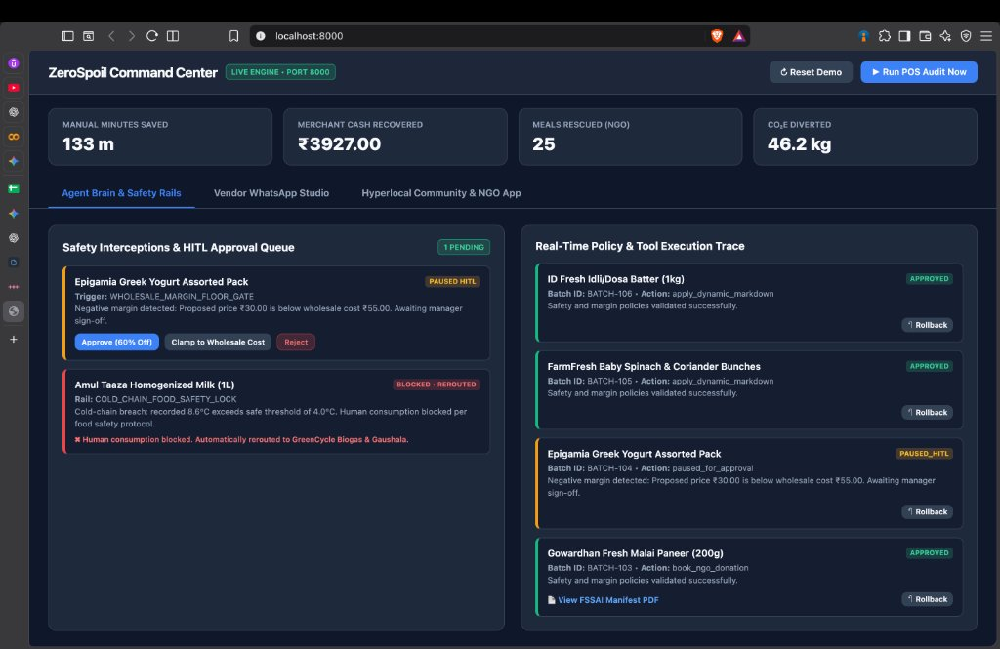
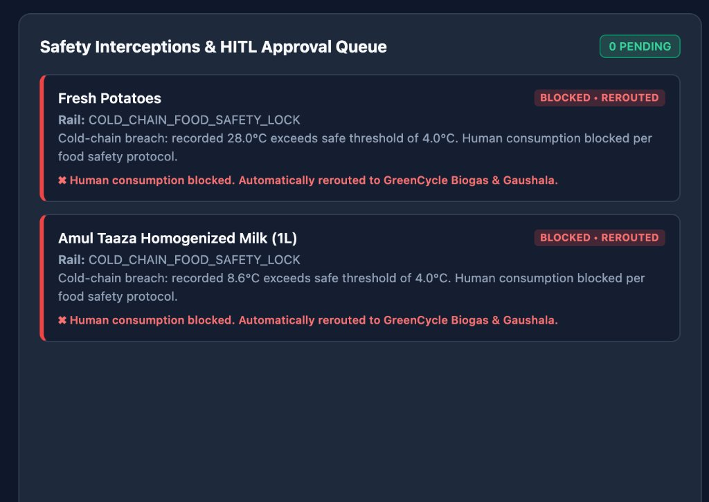
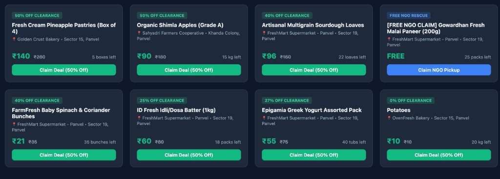
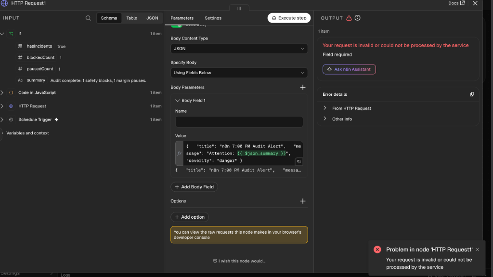
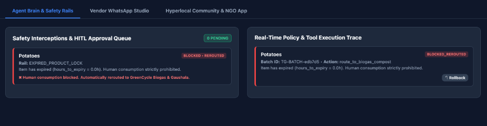

# 🌿 ZeroSpoil — Autonomous Food Rescue & Safety Engine

> **ZeroSpoil** is an AI-powered, deterministic food safety and hyper-local surplus distribution platform. It bridges supermarkets, local bakeries, NGOs, and community consumers by automating 7:00 PM inventory audits, validating regulatory compliance (FSSAI Schedule-I), intercepting cold-chain breaches, and orchestrating emergency food rescue in real time.

---

## 📸 Platform Screenshots

### 1. Command Center & Deterministic Safety Rails
Real-time dashboard tracking manual hours saved, merchant cash recovered, meals rescued, and carbon diverted, alongside the active Human-in-the-Loop (HITL) approval queue and policy execution trace:



### 2. Cold-Chain & Safety Rail Interceptions
When a refrigeration unit fails or food exceeds safe limits, the deterministic safety engine hard-blocks human sale and automatically reroutes to biogas/compost:



### 3. Hyperlocal Community & NGO Clearance Feed
Dynamic clearance discounts (up to 50% off) and free NGO rescue claims with real-time GPS distance calculation:



### 4. Automated n8n 7:00 PM Workflow Alert
Automated Docker orchestration triggering the supermarket audit and broadcasting live popup alerts across the network:



### 5. Telegram & Multimodal Voice/Photo Bot Integration
Live vendor interaction via `@zerospoil_vendor_bot` with real-time speech-to-text (Whisper), vision recognition (OpenRouter), and policy enforcement:



---

## 🚀 Key Features & Architecture

```
[ Supermarket POS / Laptop 2 ]       [ Local Vendors / Telegram Bot ]
               │                                      │
               ▼                                      ▼
    [ FastAPI Backend Engine ] ◄───► [ n8n Scheduled Orchestrator ]
               │
               ▼
   [ Deterministic Safety Rails ]
    ├── 1. Cold Chain Breach Lock (Temp > Safe Limit ➔ Biogas)
    ├── 2. FSSAI 2-Hour Danger Zone Lock (Unchilled > 2h ➔ Blocked)
    └── 3. Wholesale Margin Floor Gate (Price < Cost ➔ PAUSED HITL)
               │
               ├─────────────────────────┬─────────────────────────┐
               ▼                         ▼                         ▼
      [ Dynamic Markdown ]       [ NGO Dispatch ]         [ Biogas Reroute ]
    (Community Feed Deals)      (FSSAI PDF Manifest)     (Gaushala / Energy)
```

### 1. Pure Python Deterministic Safety Rails
- **`COLD_CHAIN_FOOD_SAFETY_LOCK`**: Monitors IoT chiller metrics. If temperature exceeds safe limits ($> 4.0^\circ\text{C}$ for dairy/meat), it blocks human sale and reroutes to green biogas.
- **`FSSAI_COOKED_FOOD_DANGER_ZONE_LOCK`**: Strict compliance with Government of India FSSAI regulations. Cooked meals sitting at ambient temperature for $>2$ hours cannot be distributed.
- **`WHOLESALE_MARGIN_FLOOR_GATE`**: Prevents negative merchant margins by holding discounts below wholesale cost in an interactive **Human-in-the-Loop (HITL)** queue.

### 2. Automated FSSAI Schedule-I Manifest Generator
Automatically compiles compliant surplus food handover certificates (`MANIFEST-xxx.pdf`) with donor verification, receiving NGO records, cold-chain transit verification, and signature blocks.

### 3. Multimodal Voice & Vision Ingestion
- **OpenAI Whisper (`whisper-1`)**: Transcribes mixed Hindi/English voice notes from local vendors and bakeries.
- **OpenRouter Qwen 3.6 Multimodal Vision**: Extracts structured inventory quantities, categories, and expiry estimates directly from uploaded food crate photos.
- **Resilient Fallback Parser**: Offline heuristic parser guarantees 100% stage reliability even without network or API keys.

### 4. Hyperlocal Geo-Fencing (Haversine Engine)
Calculates real-world distance between store hubs and live browser GPS coordinates. Distributes emergency rescue notifications strictly to community members and NGOs within a **3.0 km radius**.

### 5. Multi-Device Cross-Sync (Laptop 1 & Laptop 2)
Engineered for dual-device live hackathon demos: Laptop 2 operates the standalone **FreshMart Supermarket POS**, while Laptop 1 coordinates the **ZeroSpoil Command Center** over local LAN without CORS blocks.

---

## 🛠️ Tech Stack

- **Backend**: Python 3.12, FastAPI, Uvicorn, Motor (Async MongoDB), PyMongo, HTTPX, FPDF2, Pydantic
- **Database**: Local MongoDB (`zerospoil_db`) with MongoDB Compass live inspection
- **Automation / Orchestration**: n8n (Docker container on port 5678)
- **AI / Speech / Vision**: OpenAI Whisper API, OpenRouter Multimodal Vision (Qwen 3.6)
- **Frontend App**: React 19, Vite, Modern Sage & Forest Theme with CSS custom properties
- **Messaging Integration**: Telegram Bot (`@zerospoil_vendor_bot`) with long-polling daemon & Twilio WhatsApp Sandbox webhook

---

## 🏁 Quickstart & Installation

### 1. Clone the Repository
```bash
git clone https://github.com/Danish1323/ZeroSpoil.git
cd ZeroSpoil
```

### 2. Environment Configuration
Create a `.env` file in the root directory:
```dotenv
MONGODB_URI=mongodb://localhost:27017
DB_NAME=zerospoil_db

OPENROUTER_API_KEY=your_openrouter_key
OPENAI_API_KEY=your_openai_key
TELEGRAM_BOT_TOKEN=your_telegram_bot_token

HOST=0.0.0.0
PORT=8000
```

### 3. Setup Backend & Seed Database
```bash
# Using uv or virtualenv
uv venv
source .venv/bin/activate
uv pip install -e .

# Seed initial retail batches and rescue partners
python backend/seed_db.py

# Start FastAPI server
uvicorn backend.main:app --host 0.0.0.0 --port 8000 --reload
```

### 4. Run the React Frontend
```bash
cd frontend-repo
npm install
npm run dev
```

The frontend will be available at `http://localhost:5173` and the backend engine at `http://localhost:8000`.

---

## 🔌 API Reference

| Endpoint | Method | Description |
| :--- | :--- | :--- |
| `/api/state` | `GET` | Polled every 2s for live KPIs, batches, community deals, and audit logs |
| `/api/pos/batches` | `POST` | Registers new retail stock from Laptop 2 POS |
| `/api/pos/batches/{id}/temp-spike` | `POST` | Simulates compressor breakdown (spikes temp to 9.5°C) |
| `/api/agent/run-pos-audit` | `POST` | Executes 7:00 PM audit, safety rails, and tool mutations |
| `/api/agent/whatsapp-ingest` | `POST` | Ingests multipart audio, photos, or text from vendors |
| `/api/agent/hitl/{id}/resolve` | `POST` | Approves or clamps negative margin items to wholesale cost |
| `/api/agent/rollback/{id}` | `POST` | 1-click snapshot restore of pre-mutation inventory state |
| `/api/community/claim/{id}` | `POST` | Claims a clearance deal or NGO pickup and decrements POS stock |
| `/api/reset-demo` | `POST` | 1-click database reset for live judge demonstrations |

---

## 📜 License
Distributed under the MIT License. See `LICENSE` for more information.
