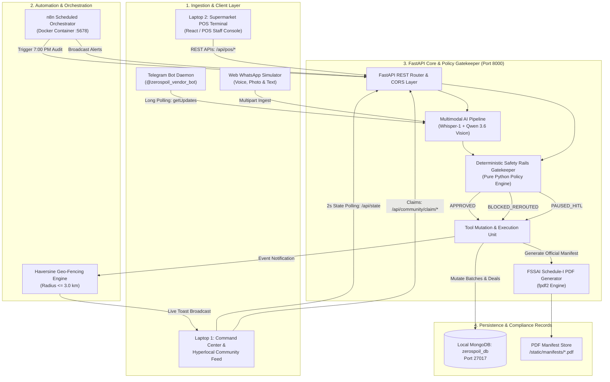
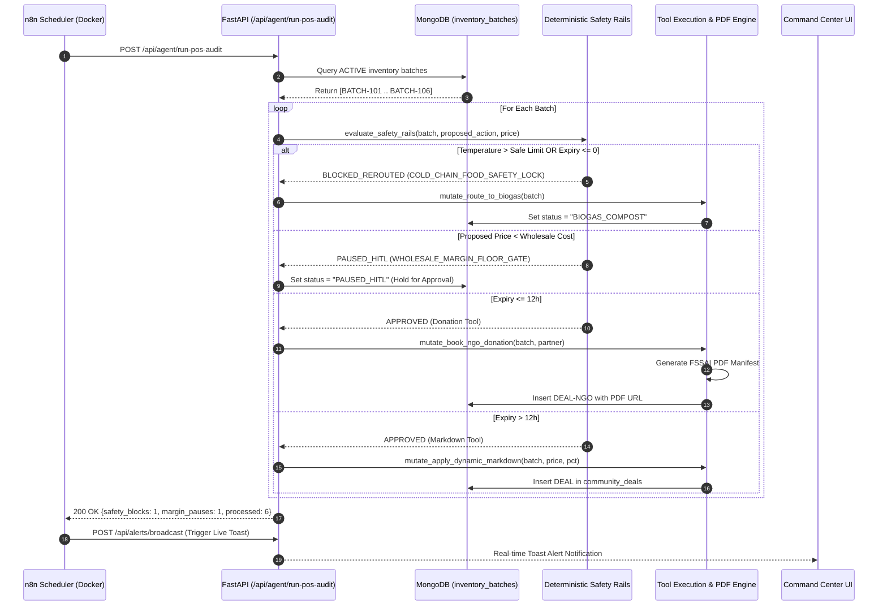
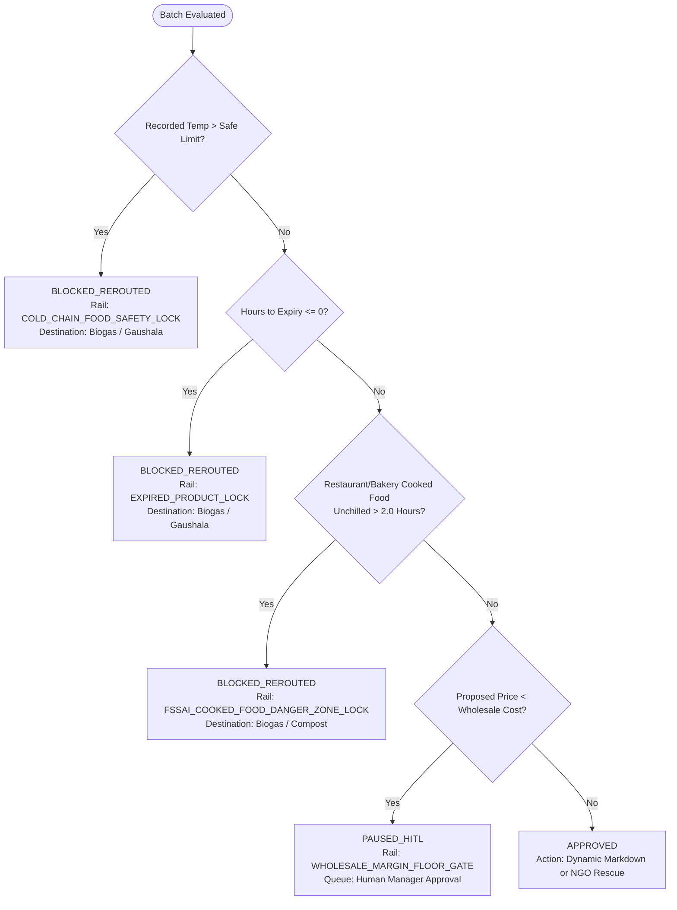
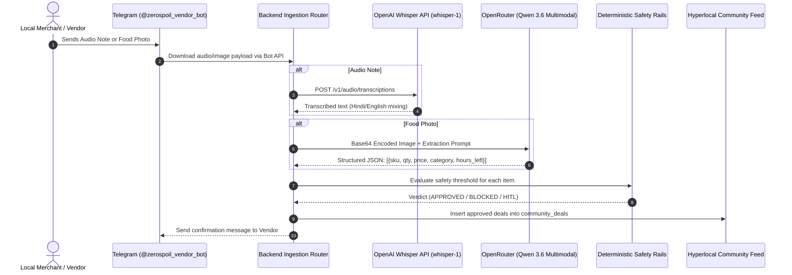
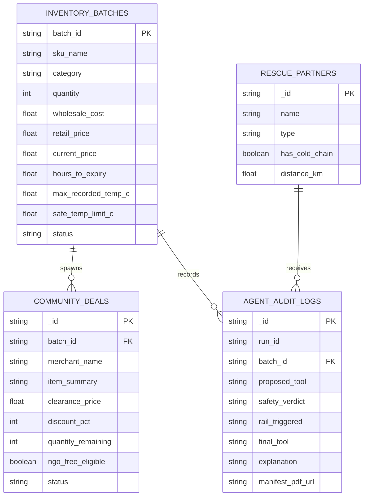

# ZeroSpoil System Architecture & Automation Engineering Report

## Executive Summary
**ZeroSpoil** is an autonomous surplus food rescue, regulatory compliance, and inventory optimization engine. It automates evening grocery markdowns, detects and isolates cold-chain food safety breaches, enforces Indian **FSSAI Schedule-I** food recovery regulations, generates verified handover compliance certificates, and distributes hyper-local surplus to community members and NGOs within walking radius.

The system is engineered as a **distributed two-node architecture** (Laptop 1: Autonomous Safety & API Engine; Laptop 2: Supermarket POS Terminal) backed by real-time IoT and multimodal ingestion pipelines.

---

## 1. High-Level System Architecture



---

## 2. Multi-Device Network Architecture (Live Hackathon Setup)

ZeroSpoil is structured across local Wi-Fi / hotspot subnets to support a collaborative live demonstration:

| Node | Responsibility | Port / Protocol | Bound IP |
| :--- | :--- | :--- | :--- |
| **Laptop 1** | FastAPI Core Engine, MongoDB, Telegram Bot, Command Center | `8000` (FastAPI), `27017` (MongoDB), `5678` (n8n), `5173` (React UI) | `0.0.0.0:8000` (`172.30.7.105`) |
| **Laptop 2** | FreshMart Supermarket POS Terminal | `3000` / `5173` | Local LAN pointing to `http://172.30.7.105:8000` |

### Cross-Origin Resource Sharing (CORS) Policy
FastAPI is configured with unrestricted cross-origin middleware to ensure Laptop 2's browser can query the backend without security blocks:
```python
app.add_middleware(
    CORSMiddleware,
    allow_origins=["*"],
    allow_credentials=True,
    allow_methods=["*"],
    allow_headers=["*"],
)
```

---

## 3. Automation Layer Deep-Dive

### 3.1 Autonomous 7:00 PM Supermarket Audit (n8n + FastAPI)
Every evening at 7:00 PM, supermarkets identify stock nearing expiration. ZeroSpoil replaces manual discounting with an autonomous pipeline:



---

## 4. Deterministic Food Safety Rails (Policy Gatekeeper)

Unlike non-deterministic LLM output, ZeroSpoil implements strict regulatory guardrails:



### Safety Rules Matrix

| Rule Name | Trigger Condition | Deterministic Action | Target Recipient |
| :--- | :--- | :--- | :--- |
| **`COLD_CHAIN_FOOD_SAFETY_LOCK`** | `max_recorded_temp_c > safe_temp_limit_c` | Blocks sale & human donation | GreenCycle Biogas & Gaushala Unit |
| **`EXPIRED_PRODUCT_LOCK`** | `hours_to_expiry < 0` | Blocks human consumption | Biogas Energy Plant |
| **`FSSAI_COOKED_FOOD_DANGER_ZONE_LOCK`** | Cooked meal unchilled $> 2.0\text{h}$ or open buffet tray | Hard-block under FSSAI 2-hr Danger Zone | Biogas / Compost |
| **`WHOLESALE_MARGIN_FLOOR_GATE`** | `clearance_price < wholesale_cost` | Pauses database mutation | Held in Manager HITL Queue |

---

## 5. Multimodal Voice & Vision Ingestion Pipeline

Small bakeries, kirana shops, and fruit vendors often lack barcode scanners. ZeroSpoil allows vendors to register surplus by sending voice notes or snapping food photos:



---

## 6. Hyperlocal Geo-Fencing Engine

To eliminate spam and ensure surplus food is rescued while still fresh, ZeroSpoil implements a **Haversine Distance Engine**:

$$\Delta\sigma = 2 \arcsin \sqrt{\sin^2\left(\frac{\Delta\phi}{2}\right) + \cos(\phi_1)\cos(\phi_2)\sin^2\left(\frac{\Delta\lambda}{2}\right)}$$

$$d = R \cdot \Delta\sigma \quad (R = 6371 \text{ km})$$

- **Anchor Node**: FreshMart Supermarket — Panvel (`18.9902° N, 73.1168° E`).
- **Geo-Fence Boundary**: $\le 3.0\text{ km}$.
- When a clearance deal or NGO rescue is announced, the client compares the device's real HTML5 GPS coordinates against the event location:
  - **Distance $\le 3.0\text{ km}$**: Displays real-time popup with distance badge (e.g. `1.4 km away`).
  - **Distance $> 3.0\text{ km}$**: Suppressed automatically to protect distant users from irrelevant alerts.

---

## 7. FSSAI Schedule-I Compliance PDF Generator

When perishable surplus is allocated to an NGO, the backend runs a dedicated PDF engine (`backend/tools.py` using `fpdf2`):
- **Certificate ID**: `MANIFEST-BATCH-<id>-<timestamp>.pdf`
- **Embedded Compliance Declarations**:
  1. Formal declaration under Food Safety and Standards (Recovery and Distribution of Surplus Food) Regulations.
  2. Timestamped temperature log and safe shelf-life duration.
  3. Cold-chain transit requirement flags (`has_cold_chain: true`).
  4. Dual signature blocks for Store Dispatch Officer and NGO Receiving Agent.

---

## 8. Database Schema Architecture (`zerospoil_db`)



---

## 9. Conclusion
ZeroSpoil integrates autonomous scheduled audits (n8n), multimodal ingestion (Whisper + Vision), and strict regulatory enforcement into a unified food rescue platform. By pairing deterministic safety rails with a reactive microservice architecture, it ensures food is distributed efficiently and safely without manual overhead.
